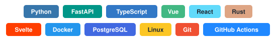

<h1 align="center">Jamie</h1>

  <b>Network automation</b> &nbsp;·&nbsp; <b>Software engineering</b> &nbsp;·&nbsp; Japan

  I build tools that make networks explain and fix themselves — 
  intent-based configuration, layered monitoring, and AI agents that find the root cause.

  

### Network operations

| Project | What it does | Stack |
|---|---|---|
| [**Fathom**](https://github.com/Jamie-233/fathom) | AIOps platform for campus networks: parses vendor CLI into data, groups alerts into **one incident per root cause** using topology, auto-fixes only what is safe and puts the rest behind human approval. Ships with a simulated Cisco/Huawei lab, so it runs on a laptop. | Python · FastAPI · SQLite · Netmiko · MCP |
| [**Strata**](https://github.com/Jamie-233/strata) | Network intent compiler: one YAML inventory → validated Cisco IOS & Huawei VRP configs, a per-interface diff against running config, and dry-run-by-default deploys. Catches VLAN, subnet and gateway mistakes before anything touches a switch. | Python · Jinja2 · Netmiko |
| [**Netlint**](https://github.com/Jamie-233/netlint) | Linter for existing Cisco IOS and Huawei VRP configs: plaintext secrets, default SNMP communities and other security and hygiene mistakes, with exit codes you can gate CI on. | Python (no dependencies) |
| [**Vigil**](https://github.com/Jamie-233/vigil) | Self-hosted monitoring in a single process: ICMP / TCP / HTTP / DNS probes, flap-resistant alerting, SLOs and error budgets, Prometheus metrics and a live dashboard — no database server, no agents, no root. | Python · asyncio · SQLite · Prometheus |
| [**Triage**](https://github.com/Jamie-233/triage) | AI agent that troubleshoots like an engineer: runs real DNS → route → TCP → TLS → HTTP checks, narrows the fault layer by layer and cites its evidence. Guardrails live in the tools (scope limits, SSRF protection, call budget). Works with local models via Ollama. | Python · OpenAI-compatible LLMs |

Strata generates new configs, Netlint checks the ones already running. Fathom works on the device side (switches, links, config); Triage works from the host side (what a user's machine can reach).

### Software

| Project | What it does | Stack |
|---|---|---|
| [**Conduit**](https://github.com/Jamie-233/conduit) | Low-code workflow builder that runs entirely in the browser: typed ports, live graph validation, parallel and cancellable execution, per-node inputs, outputs and logs. [Live demo](https://jamie-233.github.io/conduit/) | TypeScript · Vue 3 · Vite |

### What I work on

- **Configuration as code** — intent models, config generation, diffs and linting for Cisco IOS and Huawei VRP ([Strata](https://github.com/Jamie-233/strata), [Netlint](https://github.com/Jamie-233/netlint))
- **Monitoring and incident response** — layered probes, SLOs, alert correlation and root-cause analysis ([Vigil](https://github.com/Jamie-233/vigil), [Fathom](https://github.com/Jamie-233/fathom))
- **AI agents for operations** — tool-using agents with guardrails and human approval ([Triage](https://github.com/Jamie-233/triage), [Fathom](https://github.com/Jamie-233/fathom))
- **Web applications** — TypeScript and Vue front ends with tests and CI ([Conduit](https://github.com/Jamie-233/conduit))
